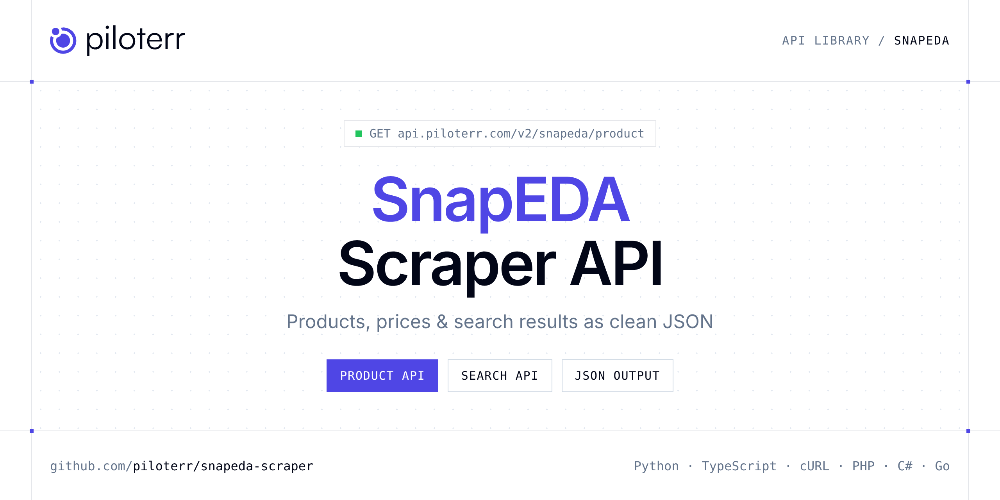

<p align="center">
  <a href="https://www.piloterr.com"></a>
</p>

# SnapEDA Scraper API

[](https://discord.gg/CFj3ph8aHU) [](https://app.piloterr.com) [](https://app.piloterr.com/openapi) [](LICENSE)

The **Piloterr SnapEDA Scraper API** lets you extract public data from SnapEDA as **clean, structured JSON** — no proxies, headless browsers or HTML parsing to maintain. Endpoints available in production:

- **SnapEDA Product API** — SnapEDA Product API: fetch full part page data from a SnapEDA URL or MPN/manufacturer slug.
- **SnapEDA Search API** — SnapEDA Search API: search electronic parts by keyword or URL on SnapMagic Search (ex-SnapEDA).

Use it for price monitoring, assortment tracking, competitor analysis, product research or catalog enrichment.

| Endpoint | Path | Credits | What you get |
|---|---|---|---|
| [SnapEDA Product API](#snapeda-product-api) | `/v2/snapeda/product` | 2 | SnapEDA Product API |
| [SnapEDA Search API](#snapeda-search-api) | `/v2/snapeda/search` | 2 | SnapEDA Search API |

## Table of contents

- [How it works](#how-it-works)
- [SnapEDA Product API](#snapeda-product-api)
- [SnapEDA Search API](#snapeda-search-api)
- [Code examples in other languages](#code-examples-in-other-languages)
- [Practical use cases](#practical-use-cases)
- [Why Piloterr?](#why-piloterr)
- [FAQ](#faq)
- [Related scrapers](#related-scrapers)
- [Support](#support)

## How it works

1. **Create a free Piloterr account** and copy your API key from the [dashboard](https://app.piloterr.com).
2. **Send a `GET` (or `POST`) request** to `https://api.piloterr.com/v2/...` with the header `x-api-key: YOUR_API_KEY`.
3. **Receive structured JSON** — Piloterr handles rendering, proxies, retries and parsing.

```bash
export PILOTERR_API_KEY="your-api-key"
pip install requests        # Python
# TypeScript: Node.js 18+ (native fetch), run with `npx tsx file.ts`
```

> Every endpoint accepts both `GET` (query string) and `POST` (JSON body with the same fields).

## SnapEDA Product API

SnapEDA Product API: fetch full part page data from a SnapEDA URL or MPN/manufacturer slug. Returns CAD models, datasheet, RoHS, distributor pricing and availability via browser rendering.

`GET | POST https://api.piloterr.com/v2/snapeda/product` · **2 credits per request** · [Full reference](https://app.piloterr.com/openapi)

### Request parameters

| Parameter | Type | Required | Description |
|---|---|---|---|
| `query` | string | ✅ | SnapEDA part page URL or `MPN/manufacturer` slug. |
| `return_page_source` | boolean | — | When `true`, return the raw rendered HTML as `{"result": "..."}` instead of structured JSON. Defaults to `false`. |

### Python example

```python
import json
import os
import requests

response = requests.get(
    "https://api.piloterr.com/v2/snapeda/product",
    headers={"x-api-key": os.environ["PILOTERR_API_KEY"]},
    params={
        "query": "CYPD3175-24LQXQ/Cypress Semiconductor",
    },
    timeout=60,
)
response.raise_for_status()
data = response.json()

print(json.dumps(data, indent=2, ensure_ascii=False)[:2000])
```

### TypeScript example

```typescript
type SnapedaProduct = {
  url?: string;
  rohs?: boolean;
  formats?: string[];
  part_id?: string;
  pricing?: {
    price?: string;
    currency?: string;
    quantity?: number;
    supplier?: string;
    price_value?: number;
  }[];
  in_stock?: boolean;
  image_url?: string;
  cad_models?: {
    symbol?: boolean;
    model_3d?: boolean;
    footprint?: boolean;
  };
  description?: string;
  part_number?: string;
  availability?: string;
  manufacturer?: string;
  datasheet_url?: string;
};

const params = new URLSearchParams({
  "query": "CYPD3175-24LQXQ/Cypress Semiconductor",
});

const response = await fetch(`https://api.piloterr.com/v2/snapeda/product?${params}`, {
  headers: { "x-api-key": process.env.PILOTERR_API_KEY! },
});
if (!response.ok) throw new Error(`Piloterr error ${response.status}: ${await response.text()}`);

const data = (await response.json()) as SnapedaProduct;

console.log(JSON.stringify(data, null, 2).slice(0, 2000));
```

<details>
<summary><b>POST variant</b></summary>

```http
POST https://api.piloterr.com/v2/snapeda/product
x-api-key: YOUR_API_KEY
Content-Type: application/json

{"query": "CYPD3175-24LQXQ/Cypress Semiconductor"}
```
</details>

### Output example

Example response from the API reference, abridged — real values depend on the page you scrape.

```json
{
  "url": "https://www.snapeda.com/parts/CYPD3175-24LQXQ/Cypress%20Semiconductor/view-part",
  "rohs": true,
  "formats": [
    "Altium",
    "Eagle"
  ],
  "part_id": "2776245",
  "pricing": [
    {
      "price": "37 x $8.30",
      "currency": "USD",
      "quantity": 54954,
      "supplier": "Featured",
      "price_value": 37
    },
    {
      "price": "239 x $1.58 500 x $1.41 1,000 x $1.31 10,000 x $1.17 100,000 x $0.98",
      "currency": "USD",
      "quantity": 1470,
      "supplier": "Verical",
      "price_value": 239
    }
  ],
  "in_stock": true,
  "image_url": "https://snapeda.s3.us-east-1.amazonaws.com/partpics/Cypress Semiconductor_CYPD3175-24L-X-_40408.jpg",
  "cad_models": {
    "symbol": true,
    "model_3d": true,
    "footprint": true
  },
  "description": "ARM® Cortex®-M0 EZ-PD™ CCG3PA USB Type C Microcontroller IC FLASH (64kB) 24-UFQFN Exposed Pad",
  "part_number": "CYPD3175-24LQXQ",
  "availability": "In Stock",
  "manufacturer": "Cypress Semiconductor",
  "datasheet_url": "https://www.snapeda.com/parts/CYPD3175-24LQXQ/Cypress%20Semiconductor/datasheet/"
}
```

### Response fields

| Field | Type | Description |
|---|---|---|
| `url` | string |  |
| `rohs` | boolean |  |
| `formats` | string[] |  |
| `part_id` | string |  |
| `pricing[]` | object[] |  |
| `pricing[].price` | string |  |
| `pricing[].currency` | string |  |
| `pricing[].quantity` | integer |  |
| `pricing[].supplier` | string |  |
| `pricing[].price_value` | integer |  |
| `in_stock` | boolean |  |
| `image_url` | string |  |
| `cad_models` | object |  |
| `cad_models.symbol` | boolean |  |
| `cad_models.model_3d` | boolean |  |
| `cad_models.footprint` | boolean |  |
| `description` | string |  |
| `part_number` | string |  |
| `availability` | string |  |
| `manufacturer` | string |  |
| `datasheet_url` | string |  |

## SnapEDA Search API

SnapEDA Search API: search electronic parts by keyword or URL on SnapMagic Search (ex-SnapEDA). Returns MPN, manufacturer, pricing, CAD availability and pagination via browser rendering.

`GET | POST https://api.piloterr.com/v2/snapeda/search` · **2 credits per request** · [Full reference](https://app.piloterr.com/openapi)

### Request parameters

| Parameter | Type | Required | Description |
|---|---|---|---|
| `query` | string | ✅ | Search keyword or full SnapEDA / SnapMagic search URL. |
| `page` | number | — | 1-based page number override (default: read from URL or `1`). SnapEDA returns 20 results per page. |
| `return_page_source` | boolean | — | When `true`, return the raw rendered HTML as `{"result": "..."}` instead of structured JSON. Defaults to `false`. |

### Python example

```python
import json
import os
import requests

response = requests.get(
    "https://api.piloterr.com/v2/snapeda/search",
    headers={"x-api-key": os.environ["PILOTERR_API_KEY"]},
    params={
        "query": "USB Type C",
    },
    timeout=60,
)
response.raise_for_status()
data = response.json()

print(json.dumps(data, indent=2, ensure_ascii=False)[:2000])
```

### TypeScript example

```typescript
type SnapedaSearch = {
  results?: {
    url?: string;
    price?: number;
    package?: string;
    part_id?: string;
    currency?: string;
    image_url?: string;
    has_symbol?: boolean;
    description?: string;
    part_number?: string;
    availability?: string;
    manufacturer?: string;
    has_footprint?: boolean;
  }[];
  pagination?: {
    page?: number;
    per_page?: number;
    total_pages?: number;
    total_results?: number;
  };
};

const params = new URLSearchParams({
  "query": "USB Type C",
});

const response = await fetch(`https://api.piloterr.com/v2/snapeda/search?${params}`, {
  headers: { "x-api-key": process.env.PILOTERR_API_KEY! },
});
if (!response.ok) throw new Error(`Piloterr error ${response.status}: ${await response.text()}`);

const data = (await response.json()) as SnapedaSearch;

console.log(JSON.stringify(data, null, 2).slice(0, 2000));
```

<details>
<summary><b>POST variant</b></summary>

```http
POST https://api.piloterr.com/v2/snapeda/search
x-api-key: YOUR_API_KEY
Content-Type: application/json

{"query": "USB Type C"}
```
</details>

### Output example

Example response from the API reference, abridged — real values depend on the page you scrape.

```json
{
  "results": [
    {
      "url": "https://www.snapeda.com/parts/CYPD3175-24LQXQ/Cypress%20Semiconductor/view-part/",
      "price": 0.93,
      "package": "Custom",
      "part_id": "2776245",
      "currency": "USD",
      "image_url": "https://snapeda.s3.amazonaws.com/pinax/images/company_logos/thumbs/Infineon-Logo.svg.png",
      "has_symbol": true,
      "description": "ARM® Cortex®-M0 EZ-PD™ CCG3PA USB Type C Microcontroller IC FLASH (64kB) 24-UFQFN Exposed Pad",
      "part_number": "CYPD3175-24LQXQ",
      "availability": "In Stock",
      "manufacturer": "Cypress Semiconductor",
      "has_footprint": true
    },
    {
      "url": "https://www.snapeda.com/parts/PI5USB30213AXEAEX/Diodes%20Zetex/view-part/",
      "price": 0.89,
      "package": "Custom",
      "part_id": "12128468",
      "currency": "USD",
      "image_url": "https://snapeda.s3.amazonaws.com/pinax/images/company_logos/thumbs/Zetex.jpg",
      "has_symbol": true,
      "description": "High Speed Type-C Dual Role Port Controller USB 3.1 T/R 24-Pin X1QFN EP",
      "part_number": "PI5USB30213AXEAEX",
      "availability": "In Stock",
      "manufacturer": "Diodes Zetex",
      "has_footprint": true
    }
  ],
  "pagination": {
    "page": 1,
    "per_page": 20,
    "total_pages": 218,
    "total_results": 4349
  }
}
```

### Response fields

| Field | Type | Description |
|---|---|---|
| `results[]` | object[] |  |
| `results[].url` | string |  |
| `results[].price` | number |  |
| `results[].package` | string |  |
| `results[].part_id` | string |  |
| `results[].currency` | string |  |
| `results[].image_url` | string |  |
| `results[].has_symbol` | boolean |  |
| `results[].description` | string |  |
| `results[].part_number` | string |  |
| `results[].availability` | string |  |
| `results[].manufacturer` | string |  |
| `results[].has_footprint` | boolean |  |
| `pagination` | object |  |
| `pagination.page` | integer |  |
| `pagination.per_page` | integer |  |
| `pagination.total_pages` | integer |  |
| `pagination.total_results` | integer |  |

## Code examples in other languages

Ready-to-run examples live in the [`examples/`](examples) folder. Each one reads your key from the `PILOTERR_API_KEY` environment variable.

| Language | Product | Search |
|---|---|---|
| cURL (Bash) | [`product`](examples/curl/product.sh) | [`search`](examples/curl/search.sh) |
| PHP | [`product`](examples/php/product.php) | [`search`](examples/php/search.php) |
| C# | [`product`](examples/csharp/Product.cs) | [`search`](examples/csharp/Search.cs) |
| Go | [`product`](examples/go/product.go) | [`search`](examples/go/search.go) |
| Java | [`product`](examples/java/ProductExample.java) | [`search`](examples/java/SearchExample.java) |
| Ruby | [`product`](examples/ruby/product.rb) | [`search`](examples/ruby/search.rb) |
| Node.js | [`product`](examples/nodejs/product.mjs) | [`search`](examples/nodejs/search.mjs) |

## Practical use cases

- **Price monitoring** — Track prices, promotions and availability over time to react to competitors.
- **Assortment & catalog tracking** — Follow new products, delisted items and category changes.
- **Competitor analysis** — Benchmark ranges, brands and positioning across retailers.
- **Product research** — Spot best-sellers and trends from search results.
- **Catalog enrichment** — Pull titles, images and attributes into your PIM or marketplace listings.

## Why Piloterr?

- **No infrastructure** — no proxies, headless browsers or CAPTCHA solving to run yourself.
- **Structured JSON** — stable, documented fields instead of brittle HTML selectors.
- **Pay per request** — transparent credit cost per endpoint, failed requests are retried for you.
- **One API key, hundreds of sources** — SnapEDA plus many other e-commerce, search and company data endpoints in the [Piloterr library](https://www.piloterr.com/library).
- **Any language** — plain HTTPS + JSON, with examples for Python, TypeScript, cURL, PHP, C#, Go, Java, Ruby and Node.js.

## FAQ

### Is it legal to scrape SnapEDA?

Collecting publicly available data is generally allowed in many jurisdictions, but rules depend on your country, the data you collect and how you use it. Avoid personal data unless you have a lawful basis, respect the website's terms where they apply, and get legal advice for your specific use case. This is not legal advice.

### Do I need proxies or a headless browser?

No. Piloterr handles rendering, proxy rotation and retries on its side. You only send an HTTPS request with your `x-api-key` header and receive JSON.

### How much does a request cost?

Credits per call: `/v2/snapeda/product` **2**, `/v2/snapeda/search` **2**. See the [Piloterr website](https://www.piloterr.com) for plans.

### What data does the SnapEDA API return?

Each endpoint returns structured JSON: **SnapEDA Product** — `url`, `rohs`, `formats`, `part_id`, `pricing[]`, `pricing[].price`; **SnapEDA Search** — `results[]`, `results[].url`, `results[].price`, `results[].package`, `results[].part_id`, `results[].currency`.

### How do I paginate SnapEDA results?

Use the `page` parameter and keep requesting while the response indicates more results.

### Can I get the raw HTML instead of JSON?

Yes. Set `return_page_source=true` and the response becomes `{"result": "..."}` with the page source.

### Which languages are supported?

Any language that can make an HTTP request. This README shows Python and TypeScript; the [`examples/`](examples) folder contains cURL, PHP, C#, Go, Java, Ruby and Node.js.

## Related scrapers

- [About You Scraper API](https://github.com/piloterr/aboutyou-scraper)
- [Action Scraper API](https://github.com/piloterr/action-scraper)
- [Aldi Scraper API](https://github.com/piloterr/aldi-scraper)
- [Alibaba Scraper API](https://github.com/piloterr/alibaba-scraper)
- [AliExpress Scraper API](https://github.com/piloterr/aliexpress-scraper)
- [Allegro Scraper API](https://github.com/piloterr/allegro-scraper)
- [All Piloterr scrapers on GitHub](https://github.com/piloterr)

## Support

- 💬 Join the [Piloterr Discord](https://discord.gg/CFj3ph8aHU) to ask questions and share what you build.
- 📚 Browse the [API reference (OpenAPI)](https://app.piloterr.com/openapi) and the [Piloterr library](https://www.piloterr.com/library).
- 🔑 [Get your API key](https://app.piloterr.com).

---

<p align="center">
  <a href="https://www.piloterr.com">
    <picture>
      <source media="(prefers-color-scheme: dark)" srcset="images/logo-dark.svg">
      
    </picture>
  </a>
  <br>
  <sub>Built by <a href="https://www.piloterr.com">Piloterr</a> — web scraping APIs for e-commerce, search, real estate and more, one API key.</sub>
</p>

<sub>SnapEDA is a trademark of its respective owner. This repository is not affiliated with or endorsed by SnapEDA. Examples are released under the MIT license.</sub>
